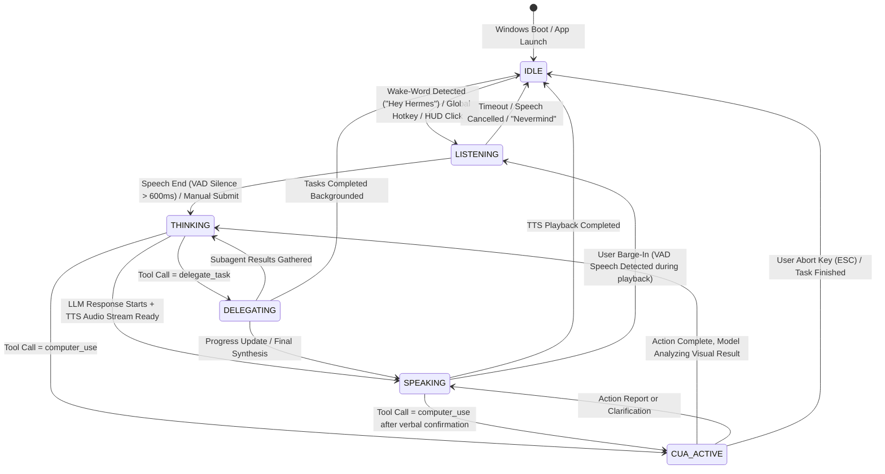

# Voice-First Windows AI Operating System (AI OS) Shell Specification

This document defines the architectural specification, state machine, and IPC event contracts for transforming `apps/desktop` into an ambient, hands-free Voice-First AI Operating System Shell on Windows 11/10.

---

## 1. System Topology & 3-Tier Authority Model

The architecture strictly adheres to the Hermes Desktop invariant:

```
┌────────────────────────────────────────────────────────────────────────┐
│                        WINDOWS OPERATING SYSTEM                         │
│  - Startup Auto-Launch (Run key / LoginItem)   - Microphone Capture    │
│  - System Tray & Global Shortcuts              - Speaker TTS Playback  │
│  - Desktop Windows & UI Compositor             - cua-driver Automation │
└────────────────────────────────────────────────────────────────────────┘
                                    ▲
                                    │ (Native OS APIs)
                                    ▼
┌────────────────────────────────────────────────────────────────────────┐
│                          ELECTRON MAIN PROCESS                         │
│  - Lifecycle: boot-at-login, single-instance lock, tray icon           │
│  - Window Manager: HUD, Workspace Canvas, CUA Overlay, Wake Indicator   │
│  - Wake-Word Engine (Local ONNX utility worker / Porcupine / Sherpa)   │
│  - Audio Pipeline Bridge: duplex 16kHz PCM audio & barge-in detector   │
│  - Native Capability Bridge: typed ContextBridge IPC                   │
└────────────────────────────────────────────────────────────────────────┘
          ▲                                             ▲
          │ (ContextBridge IPC)                         │ (Local WebSocket / JSON-RPC)
          ▼                                             ▼
┌───────────────────────────────┐             ┌──────────────────────────┐
│      REACT RENDERER (UI)      │             │   HERMES GATEWAY / CORE  │
│ - Floating Voice HUD          │             │ - AIAgent Turn Loop      │
│ - AI Employees Dashboard      │             │ - Prompt Cache Authority │
│ - CUA Set-of-Marks Overlay    │             │ - Computer Use Tool      │
│ - Workspace Canvas Shell      │             │ - Subagent Delegation    │
│ - Nanostores State Engine     │             │ - STT & Streaming TTS    │
└───────────────────────────────┘             └──────────────────────────┘
```

### The Three Authorities
1. **The Gateway / Core** is authoritative for agent sessions, conversations, prompt caching, model reasoning, tool invocations, and subagent lifecycles.
2. **Electron Main** is authoritative for OS machine facts, audio hardware capture/streaming, autostart settings, system tray presence, window visibility, and native OS input dispatch.
3. **The Renderer** is authoritative for presentation, UI animations, local audio playback synchronization, and ephemeral user interaction state.

---

## 2. Window Modes & OS Shell Display Architecture

The application runs continuously from Windows startup, transitioning seamlessly across 4 distinct windowing surfaces:

| Mode | Window Role | Frame / Backdrop | Focus & Click Behavior |
|---|---|---|---|
| `HUD` | Compact floating voice pill & waveform indicator | Frameless, transparent, DWM Mica/Acrylic frosted glass | Draggable, always-on-top, click-through when dormant, expandable transcript |
| `CANVAS` | Full desktop AI productivity workspace | Standard frameless styled shell with custom window controls | Normal interactive application window, AI employee cards, live canvas |
| `CUA_OVERLAY` | Visual feedback overlay for Computer Use Agent | Fullscreen transparent transparent canvas (`transparent: true`) | Strict `setIgnoreMouseEvents(true, { forward: true })`, draws bounding boxes & click ripples |
| `MINIMIZED_TRAY` | Background daemon | No window rendered | System tray icon with voice status dot, background wake-word listening |

---

## 3. Interaction & Voice State Machine

The shell interaction model is driven by a deterministic finite state machine (FSM):



### State Definitions:
1. `IDLE`: Microphone monitoring active for wake-word only (low CPU consumption). HUD is collapsed to ambient status or hidden in tray.
2. `LISTENING`: Real-time audio capture active. HUD expands showing dynamic audio waveform and live transcription text.
3. `THINKING`: Prompt submitted to Gateway. HUD displays pulsing aurora/orb animation.
4. `SPEAKING`: Gateway streams TTS audio chunks. Renderer plays audio with lip-sync waveform; full-duplex VAD listens for user barge-in.
5. `CUA_ACTIVE`: Desktop automation executing. CUA overlay displays Set-of-Marks badges, target highlights, and simulated cursor movements.
6. `DELEGATING`: Multi-agent subagents spawned in sandboxes. HUD shows employee status badges; AI Employees Dashboard renders active workers.

---

## 4. IPC Event Contracts (TypeScript Definitions)

All communications between Electron Main, Preload ContextBridge, React Renderer, and Hermes Core are strictly typed.

### 4.1 Voice IPC Interface

```typescript
// Channel: 'hermes:voice:*'
export type VoiceState = 'IDLE' | 'LISTENING' | 'THINKING' | 'SPEAKING' | 'CUA_ACTIVE' | 'DELEGATING'

export interface WakeWordEvent {
  keyword: string
  confidence: number
  timestamp: number
}

export interface AudioChunkPayload {
  pcmData: ArrayBuffer // 16kHz 16-bit mono PCM
  rmsLevel: number    // 0.0 to 1.0 for waveform visualization
}

export interface VoiceTranscriptPayload {
  text: string
  isFinal: boolean
  confidence: number
}

export interface VoiceTtsChunkPayload {
  audioBase64: string
  mimeType: 'audio/wav' | 'audio/mp3' | 'audio/pcm'
  isLastChunk: boolean
  turnId: string
}

export interface VoiceIpcApi {
  getState: () => Promise<VoiceState>
  setState: (state: VoiceState) => Promise<void>
  onStateChanged: (callback: (state: VoiceState) => void) => () => void
  onWakeWord: (callback: (event: WakeWordEvent) => void) => () => void
  onAudioStream: (callback: (chunk: AudioChunkPayload) => void) => () => void
  onTranscript: (callback: (transcript: VoiceTranscriptPayload) => void) => () => void
  playTtsChunk: (chunk: VoiceTtsChunkPayload) => Promise<void>
  interrupt: () => Promise<void> // User barge-in
}
```

### 4.2 Subagent Telemetry IPC Interface ("AI Employees")

```typescript
// Channel: 'hermes:subagent:*'
export type SubagentStatus = 'queued' | 'running' | 'completed' | 'failed' | 'interrupted'

export interface SubagentSpawnPayload {
  subagentId: string
  parentId: string | null
  delegationId: string
  goal: string
  model: string
  taskIndex: number
  taskCount: number
  sandboxPath: string
  startedAt: number
}

export interface SubagentProgressPayload {
  subagentId: string
  delegationId: string
  turn: number
  currentTool?: string
  toolArgumentsPreview?: string
  thinkingSnippet?: string
  tokensUsed: {
    input: number
    output: number
  }
  costUsd?: number
  updatedAt: number
}

export interface SubagentArtifactPayload {
  subagentId: string
  delegationId: string
  path: string
  action: 'created' | 'modified' | 'deleted'
  sizeBytes: number
  previewSnippet?: string
  timestamp: number
}

export interface SubagentCompletedPayload {
  subagentId: string
  delegationId: string
  status: SubagentStatus
  durationSeconds: number
  summary: string
  totalInputTokens: number
  totalOutputTokens: number
  totalCostUsd: number
  filesWritten: string[]
  completedAt: number
}

export interface SubagentControlPayload {
  subagentId: string
  action: 'steer' | 'stop' | 'pause' | 'resume'
  message?: string
}

export interface SubagentIpcApi {
  list: () => Promise<SubagentSpawnPayload[]>
  control: (payload: SubagentControlPayload) => Promise<{ success: boolean; error?: string }>
  onSpawn: (callback: (payload: SubagentSpawnPayload) => void) => () => void
  onProgress: (callback: (payload: SubagentProgressPayload) => void) => () => void
  onArtifact: (callback: (payload: SubagentArtifactPayload) => void) => () => void
  onCompleted: (callback: (payload: SubagentCompletedPayload) => void) => () => void
}
```

### 4.3 Computer Use Agent (CUA) Overlay IPC Interface

```typescript
// Channel: 'hermes:cua:*'
export interface CuaUIElement {
  id: number // 1-based Set-of-Marks ID
  label: string
  role: string
  bounds: {
    x: number
    y: number
    width: number
    height: number
  }
}

export interface CuaCapturePayload {
  sessionId: string
  targetApp: string
  windowId: number
  screenshotBase64: string
  width: number
  height: number
  elements: CuaUIElement[]
  timestamp: number
}

export interface CuaActionStartPayload {
  sessionId: string
  action: 'click' | 'double_click' | 'right_click' | 'type' | 'key' | 'drag' | 'scroll'
  coordinate?: [number, number]
  elementId?: number
  text?: string
  keys?: string
  targetBounds?: { x: number; y: number; width: number; height: number }
  timestamp: number
}

export interface CuaActionEndPayload {
  sessionId: string
  action: string
  success: boolean
  error?: string
  elapsedMs: number
  timestamp: number
}

export interface CuaIpcApi {
  onCapture: (callback: (payload: CuaCapturePayload) => void) => () => void
  onActionStart: (callback: (payload: CuaActionStartPayload) => void) => () => void
  onActionEnd: (callback: (payload: CuaActionEndPayload) => void) => () => void
  abort: () => Promise<void> // Safety abort (ESC or voice command)
}
```

### 4.4 Windows Shell & System Tray IPC Interface

```typescript
// Channel: 'hermes:system:*'
export type ShellWindowMode = 'hud' | 'canvas' | 'cua_overlay' | 'minimized'

export interface StartupStatus {
  enabled: boolean
  openAsHidden: boolean
  registryKey: string
}

export interface TrayState {
  voiceState: VoiceState
  tooltip: string
  badgeCount?: number
}

export interface SystemIpcApi {
  getStartupStatus: () => Promise<StartupStatus>
  toggleStartup: (enable: boolean) => Promise<StartupStatus>
  setWindowMode: (mode: ShellWindowMode) => Promise<void>
  getWindowMode: () => Promise<ShellWindowMode>
  setTrayState: (state: TrayState) => Promise<void>
  onWindowModeChanged: (callback: (mode: ShellWindowMode) => void) => () => void
}
```

---

## 5. Subagent Sandboxing & Concurrency Architecture

### 5.1 Sandbox Isolation
- Every delegated child subagent executes in an isolated filesystem worktree under:
  `%USERPROFILE%\.hermes\sandboxes\<subagent_id>\`
- Parent AIAgent grants isolated working directories to children. File operations by the subagent are restricted to its sandbox root, preventing collision between concurrent workers.
- Worktree synchronization: On task completion, artifacts generated by the subagent are audited, staged, and presented as reviewable patches to the parent turn.

### 5.2 Concurrency & Resource Budgeting
- Concurrent subagent execution pool governed by `tools/delegate_tool_config.py` (`_DEFAULT_MAX_CONCURRENT_CHILDREN`).
- Telemetry heartbeats (`_HEARTBEAT_INTERVAL = 30s`) prevent gateway timeout while tracking real-time token count, tool calls, and model spend.
- The UI surfaces these as "AI Employees" in the AI Employees Dashboard with live CPU/token gauges and cancel/steer controls.

---

## 6. Computer Use Agent (CUA) Desktop Automation Architecture

### 6.1 Integration with `tools/computer_use/`
- Backed by the system `cua-driver` daemon, managed per Hermes session in `tools/computer_use/tool.py`.
- Non-stealing input injection: CUA actions do not steal active foreground cursor focus when operating on background windows.
- Set-of-Marks (`som`) pipeline:
  1. Capture window screenshot + accessibility tree.
  2. Overlay numbered badge tags on interactable elements.
  3. Vision-language model selects target by tag integer (`element=N`) rather than hallucinating raw pixel coordinates.

### 6.2 Visual CUA Overlay
- Fullscreen, click-through Electron window running on Windows DWM.
- Listens to `hermes:cua:capture` and renders interactive SOM badges, highlighted targets, and animated trajectory lines.
- Safety Guard: Windows Global Keyboard Hook listens for `Escape` or immediate voice interrupt ("Stop Hermes") to instantly terminate `cua-driver` input injection.

---

## 7. Windows System Integration & Lifecycle

1. **Auto-Start at Boot**:
   - Registered via Electron `app.setLoginItemSettings({ openAtLogin: true, openAsHidden: true, path: process.execPath, args: ['--boot-startup'] })`.
   - Windows Registry fallback: `HKCU\Software\Microsoft\Windows\CurrentVersion\Run`.
2. **System Tray Integration**:
   - Custom tray icon with dynamic 16x16 status dot reflecting current `VoiceState`:
     * Grey: `IDLE`
     * Cyan Pulse: `LISTENING`
     * Violet Pulse: `THINKING`
     * Green Wave: `SPEAKING`
     * Amber: `CUA_ACTIVE`
     * Blue: `DELEGATING`
   - Tray Context Menu: Quick Summon HUD, Open Workspace Canvas, Toggle Microphone Mute, Settings, Check for Updates, Exit.
3. **Global Windows Shortcuts**:
   - `Win + Shift + Space` or `Ctrl + Alt + H`: Instant voice summon / toggle HUD.
   - `Escape`: Instant emergency stop for voice, TTS, and CUA automation.

---

## 8. Frontend UI Component Architecture in `apps/desktop/src/`

The UI architecture adds modular, high-performance visual surfaces within the existing contribution shell:

```
apps/desktop/src/
├── app/
│   ├── voice-hud/             # Floating Voice HUD
│   │   ├── voice-hud-shell.tsx      # Main HUD container & spring animations
│   │   ├── audio-waveform.tsx       # WebGL / Canvas low-latency audio visualizer
│   │   ├── speech-transcript.tsx    # Live streaming STT caption band
│   │   └── voice-action-pills.tsx   # Visual action status & cancel chips
│   ├── employees-dashboard/   # AI Employees Multi-Agent Dashboard
│   │   ├── employees-grid.tsx       # Concurrent subagent card grid
│   │   ├── employee-card.tsx        # Worker status, avatar, goal, current tool
│   │   ├── worktree-artifacts.tsx   # Live sandboxed file changes & diff viewer
│   │   └── employee-controls.tsx    # Steer, pause, interrupt buttons
│   ├── cua-overlay/           # Transparent Desktop Automation Overlay
│   │   ├── som-tag-renderer.tsx     # Set-of-Marks badge rendering canvas
│   │   ├── cursor-trail.tsx         # Action indicator & ripple animations
│   │   └── safety-indicator.tsx     # Killswitch indicator banner
│   └── workspace-canvas/      # Extended Workspace Canvas
│       └── canvas-root.tsx          # Multi-window orchestrator & session hub
└── store/
    ├── voice-state.ts         # Nanostore for VoiceState & live RMS volume
    ├── subagent-telemetry.ts  # Nanostore tracking concurrent AI employees
    └── cua-state.ts           # Nanostore tracking active automation actions
```

---

## 9. Implementation Roadmap

1. **Phase 1: Voice IPC & State Machine Foundation**
   - Implement `voiceIpc` in `electron/preload.ts` and `electron/main.ts`.
   - Create local audio capture & VAD stream engine.
   - Wire `VoiceState` transitions with Nanostores in `src/store/voice-state.ts`.
2. **Phase 2: Windows Startup & System Tray Shell**
   - Implement `startup:toggle` and `window:set_mode` handlers.
   - Integrate Windows System Tray with dynamic voice status badges.
3. **Phase 3: CUA Visual Overlay Bridge**
   - Connect `tools/computer_use/` events to Electron IPC `hermes:cua:*`.
   - Build transparent overlay window for SOM badges and action paths.
4. **Phase 4: AI Employees Dashboard UI**
   - Wire `subagent:*` telemetry events from `tools/delegate_tool.py` through Gateway.
   - Build `employees-grid.tsx` in `apps/desktop/src/app/employees-dashboard/`.
